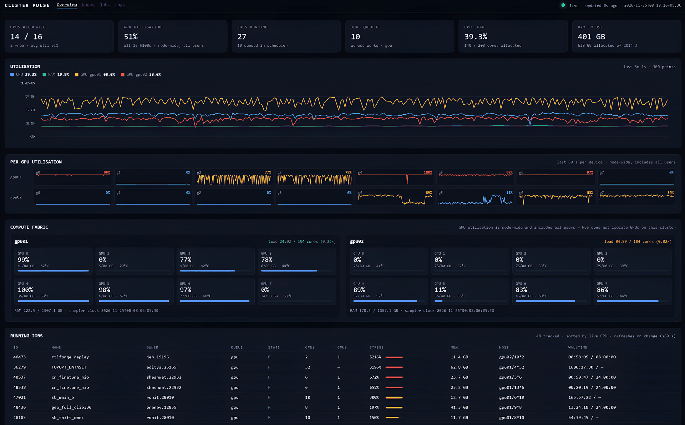
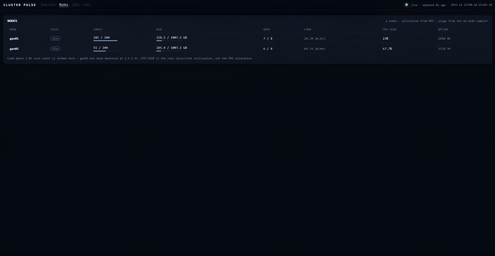
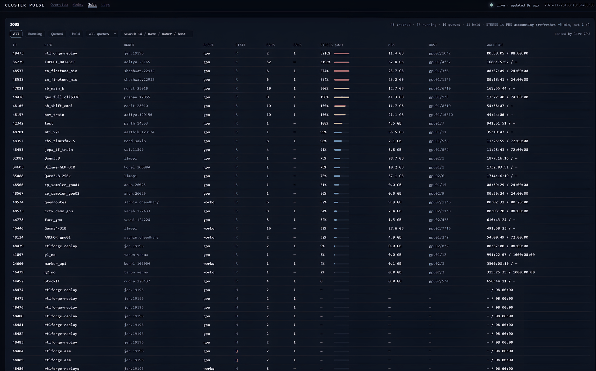
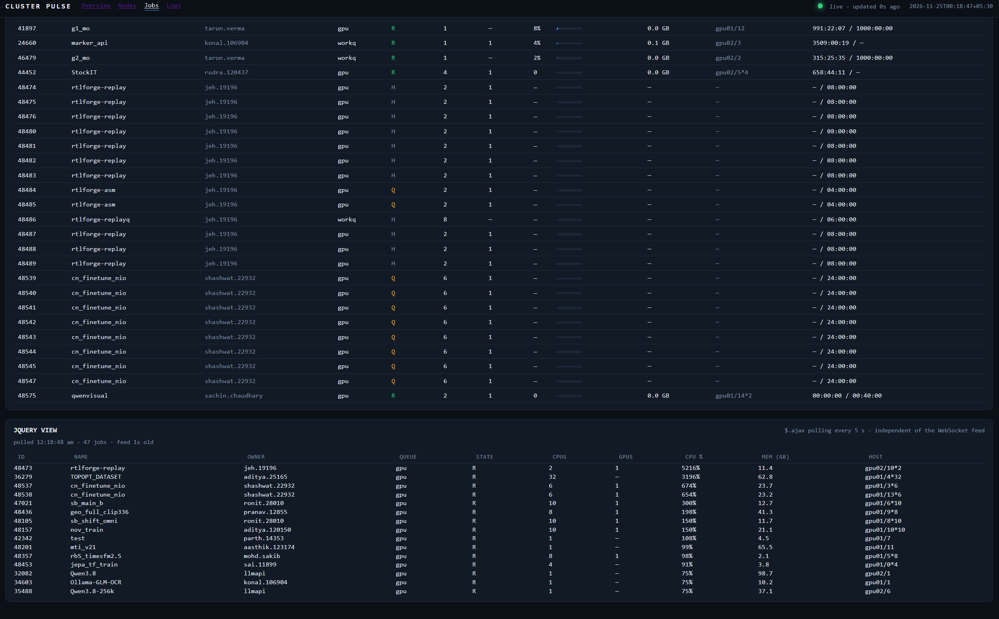
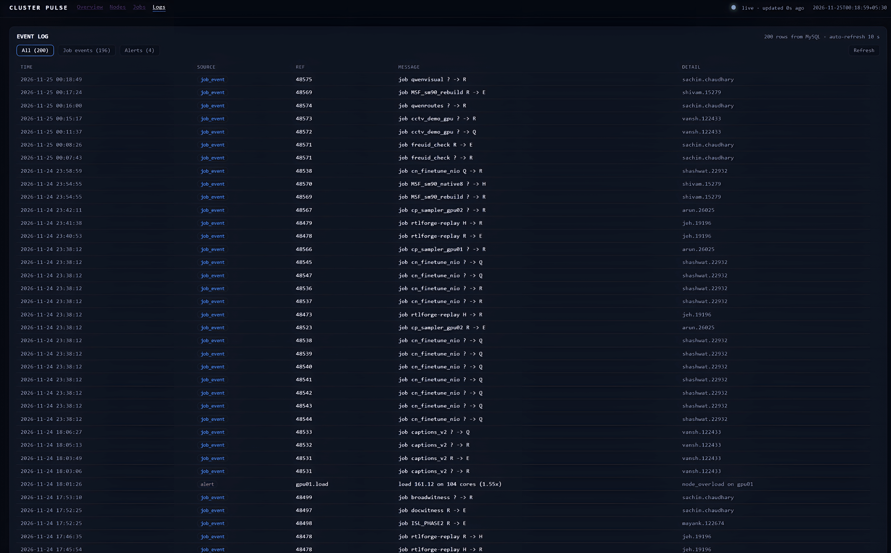

# HPC Cluster Pulse

Live monitoring for a **PBS Pro** HPC cluster — 1 Hz sampling on the GPU nodes, a delta-batched collector on the login node, a Node/Express + WebSocket API, MySQL for history, and an Angular dashboard.

Built for the UPES HPC cluster (`mgmt01`, `gpu01`, `gpu02`): 2 nodes · 208 cores · ~2 TB RAM · 16 × NVIDIA H100 80GB HBM3.

**It is not "real-time".** Measured end-to-end latency is **~1.2 s typical, ~3 s worst case**, and ~1 s is a physical floor because `nvidia-smi` averages GPU utilisation over a ~1-second window. Sampling faster would repeat numbers, not produce newer ones.

---

## Table of contents

- [Why this exists](#why-this-exists)
- [Architecture](#architecture)
- [How data reaches the laptop from a GPU node](#how-data-reaches-the-laptop-from-a-gpu-node)
- [Repository structure](#repository-structure)
- [What happens in one second](#what-happens-in-one-second)
- [HPC side](#hpc-side)
- [Laptop side](#laptop-side)
- [Database](#database)
- [Screenshots](#screenshots)
- [Setup](#setup)
- [Operating it](#operating-it)
- [Measured facts about this cluster](#measured-facts-about-this-cluster)
- [Known limits and gotchas](#known-limits-and-gotchas)
- [Verification](#verification)
- [Further reading](#further-reading)

---

## Why this exists

The cluster's own tools answer one question at a time (`qstat`, `pbsnodes`, `nvidia-smi`), but there is no single live picture: how loaded the nodes are, what each GPU is doing right now, who is consuming CPU, and what changed in the last hour.

Two hard constraints shaped the entire design:

1. **No agent can be installed on the login node and exposed to the internet.** It has no inbound reachability, and long-running work there violates cluster policy.
2. **The link between laptop and cluster is unreliable.** SSH handshakes drop roughly 1 in 3, and the VPN hands out a new client address on almost every reconnect.

Everything below is a consequence of those two facts.

---

## Architecture

```
┌─────────────────────────────┐        ┌─────────────────────────────┐
│ gpu01  (PBS job)            │        │ gpu02  (PBS job)            │
│  sampler.py @ 1 Hz          │        │  sampler.py @ 1 Hz          │
│   /proc/stat   → real CPU   │        │                             │
│   /proc/meminfo→ real RAM   │        │                             │
│   nvidia-smi   → 8 × H100   │        │                             │
│   nvidia-smi   → GPU procs  │        │                             │
└──────────┬──────────────────┘        └──────────┬──────────────────┘
           │ atomic write                         │
           ▼                                      ▼
   ~/monitor/latest-gpu01.json          ~/monitor/latest-gpu02.json
   ~/monitor/metrics-gpu01-YYYYMMDD.log metrics-gpu02-YYYYMMDD.log
           │                                      │
           └────────── $HOME is shared Lustre ────┘
                              │
                              ▼
        ┌──────────────────────────────────────────────┐
        │ mgmt01 (login node) — collector.py @ 1 Hz    │
        │   reads both latest-*.json                   │
        │   caches qstat -f + pbsnodes -av (every 5 s) │
        │   builds one cluster_snapshot (~3.5 KB)      │
        │   POSTs → laptop    (only outbound link)     │
        │   on failure → outbox.jsonl, drained later   │
        └───────────────────┬──────────────────────────┘
                            │ HTTP POST /api/ingest/cluster
                            ▼
        ┌──────────────────────────────────────────────┐
        │ laptop — Node/Express :3000                  │
        │   validates, merges job-usage deltas         │
        │   broadcasts over WebSocket /stream          │
        │   every 10 s writes rollups to MySQL         │
        └───────┬───────────────────────┬──────────────┘
                │                       │
                ▼                       ▼
        MySQL (Docker)           Angular :4200
        cluster_pulse            Overview / Nodes / Jobs / Logs
                                 + jQuery polling table
                                 + /live fallback page
```

---

## How data reaches the laptop from a GPU node

This is the part that surprised us, and it drove the whole design.

1. **The samplers run inside PBS jobs on the compute nodes** — not as daemons. `qsub` starts `sampler.py` under `-q gpu`, pinned to a host, with a 24 h walltime; the scheduler's own watchdogs resubmit them.
2. **The compute nodes cannot reach the laptop.** They sit on `10.17.1.0/24` and have no route to the laptop's `10.22.x` VPN address (measured: `curl` exits 7). So they never POST anything.
3. **They write files instead.** `latest-<node>.json` is rewritten atomically (temp file + `rename`) so a reader never sees a half-written sample. `metrics-<node>-YYYYMMDD.log` is append-only and pruned after 7 days.
4. **`$HOME` is shared Lustre**, so the moment a node writes its file it is visible on the login node — no transfer, no credentials, no extra service.
5. **Only `mgmt01` talks to the laptop.** It merges the two files with scheduler state and POSTs one snapshot per second. Measured from the login node: `HTTP 200` to the laptop API.
6. **When the laptop is unreachable**, the collector appends to `outbox.jsonl` (bounded at 50 MB) and drains it later in slices of 20 snapshots per tick, so a multi-hour outage costs buffering space, not data.

That single outbound hop is why the whole thing survives VPN drops: nothing on the cluster needs to know the laptop's address except one file, `post_url.txt`.

---

## Repository structure

```
HPC-cluster-pulse/
├── hpc-pipeline/             # ── HPC side (files that live on the cluster, not the laptop)
│   ├── sampler.py            #   1 Hz node sampler, runs inside a PBS job on gpu01/gpu02
│   ├── sampler.pbs           #   PBS wrapper: -q gpu, 24 h, 1 CPU, 1 GB
│   ├── collector.py          #   ETL on mgmt01: merge node files + PBS, POST, buffer
│   ├── watchdog.sh           #   progress-based sampler watchdog (cron, every 2 min)
│   ├── pulse.sh              #   control panel: status / start / stop / restart / logs / watch
│   └── SETUP_PROMPT.md       #   the brief used to build the cluster side
│
├── server/                   # ── Laptop API (Node + Express + WebSocket)
│   ├── src/server.js         #   endpoints, in-memory state, WS broadcast, alert derivation
│   ├── src/db.js             #   MySQL pool, schema bootstrap, rollups, history queries
│   ├── src/schema.sql        #   6 tables + 1 view
│   ├── src/live.html         #   dependency-free live page at :3000/live
│   ├── api_test.mjs          #   end-to-end test suite (13 checks)
│   └── .env.example          #   copy to .env, then fill in MySQL credentials
│
├── cluster-pulse/            # ── Angular dashboard (standalone components, signals)
│   └── src/app/
│       ├── core/             #   models.ts, cluster-pulse.service.ts (WebSocket + state)
│       ├── overview/         #   KPI cards, GPU tiles, usage chart, sparklines, jobs table
│       ├── nodes/            #   per-node table
│       ├── jobs/             #   job table + filters + jQuery polling table
│       └── logs/             #   job events and alerts from MySQL
│
├── ui/                       # ── Figma Make prototype (React) — visual reference only
├── pulse.ps1 / pulse.cmd     # ── laptop control: status/start/stop/restart/logs/watch
├── register-ip-sync.ps1      # registers the hidden task that keeps post_url.txt current
├── sql.cmd                   # MySQL console wrapper (reads credentials from server/.env)
├── queries.sql               # seven demo queries for the MySQL viva
└── LEARN-THE-PROJECT.md      # the full engineering record: decisions, probes, bugs, measurements
```

`ui/` is **not** the graded artifact — it is the React prototype used to settle the visual design before rebuilding it in Angular.

---

## What happens in one second

| Time | Where | What |
|---|---|---|
| 0.00 s | gpu01, gpu02 | `sampler.py` wakes, reads `/proc/stat` and `/proc/meminfo`, runs two `nvidia-smi` queries, writes `latest-<node>.json` (~3 KB, tmp + rename), appends one line to the daily log |
| ~0.05 s | Lustre → mgmt01 | the new file becomes visible on the login node |
| 0.10 s | mgmt01 | collector tick: reads both node files, uses cached PBS data (refreshed every 5 s), assembles `cluster_snapshot`, POSTs it |
| 0.15 s | laptop | Express validates, merges job-usage deltas, broadcasts to WebSocket clients, keeps the snapshot in memory |
| 0.16 s | browser | Angular receives the push and re-renders — no polling, no timer |
| every 10 s | laptop | the snapshot is written to MySQL as a rollup row (never one row per second) |

### The delta contract (worth understanding before debugging "empty" data)

Payloads are deliberately small, which means **some fields are deltas, not state**:

| Field | Meaning |
|---|---|
| `jobs: null` + `jobs_state: "unchanged"` | the job list has not changed; reuse the previous one |
| `job_usage: [[id, cpupercent, mem_kb], …]` | only the rows that changed since the last tick — usually `[]` |
| `usage_full: true` | this tick carries the whole usage list; replace rather than merge |
| `apps: []` (omitted) | GPU-process list is sent only every 15 s |

The laptop API implements that contract: it inherits the previous job list when `jobs` is null, and upserts usage rows into a Map that is cleared only when `usage_full` is true. **An empty delta therefore never erases anything.**

### Backfill, and why the live view cannot be hijacked

Two ordering rules keep the live view honest, and both were learned the hard way:

- **The outbox drains on its own thread, never inside the tick.** Draining inline meant each tick
  waited on 4–6 buffered POSTs before writing the live snapshot, so the cadence fell to ~0.4 Hz
  and the whole dashboard appeared to refresh every 3 seconds. Backfill now runs on a daemon
  thread with a lock on the outbox file; the live tick does exactly one thing per second.
- **The API rejects out-of-order snapshots.** A snapshot whose `ingest_ts` is older than the
  current one gets `202 Accepted` and is dropped from the buffer — it never becomes live state
  and is never broadcast. Without this, a drain could leave the dashboard showing hour-old values
  under a "live · updated 0s ago" header, because that header measures arrival time, not the age
  of the data.

Net effect: a large backlog is backfilled in the background at its own rate, and the live
1 Hz view is unaffected while it drains.

**Consequence worth knowing:** because the merge Map lives in API memory, per-job usage reads as empty for up to 60 s after every API restart, until the first `usage_full` tick arrives. That is not a bug — just give it a minute before demoing.

---

## HPC side

All files live in `~/monitor` on the login node; the samplers run on the compute nodes.

| File | Purpose |
|---|---|
| `sampler.py` | Runs **inside a PBS job**. Each second: 8 GPUs (utilisation, memory, temperature, power), processes holding GPU memory and their owners, load average, real CPU % from a `/proc/stat` delta, RAM from `/proc/meminfo`. Atomic write + append to the daily log; prunes logs older than 7 days. Commands run on daemon threads so a wedged `nvidia-smi` can never freeze the loop. |
| `sampler.pbs` | PBS wrapper: `-q gpu`, 24 h walltime, 1 CPU, 1 GB, no `#PBS -o` (it silently lost output on this cluster). |
| `collector.py` | The ETL stage on `mgmt01`: merges node files with scheduler state, slims the payload, POSTs, buffers to an outbox when the laptop is unreachable, re-reads `post_url.txt` every 5 s. |
| `start_collector.sh` | Idempotent starter — no-ops if a collector is already running. |
| `watchdog.sh <node>` | Judges health by **data progress**, not by job state: if `latest-<node>.json` stops being rewritten for 180 s, it kills the job and queues a fresh one. |
| `pulse.sh` | Control panel: `status` (6 checks), `start`, `stop`, `restart`, `logs`, `watch`, plus a numbered menu. |
| `post_url.txt` | The laptop endpoint, e.g. `http://10.22.0.196:3000/api/ingest/cluster`. |
| `latest-<node>.json` | Newest sample per node. |
| `latest-snapshot.json` | Newest merged snapshot — **a delta document**, for local inspection only. |
| `metrics-<node>-YYYYMMDD.log` | 1 Hz append-only history (~24 MB/day/node). The only record of any window the API missed. |
| `outbox.jsonl` | Bounded buffer (50 MB) used while the laptop is unreachable. |
| `collector.log` | Timestamped collector output: POST failures, backfills, target changes. |

### Unattended operation (crontab)

```
SHELL=/bin/bash
PATH=/opt/pbs/bin:/usr/local/bin:/usr/bin:/bin
@reboot cd ~/monitor && { nohup python3 collector.py --post "$(cat post_url.txt)" >> collector.log 2>&1 & }
*/5 * * * * pgrep -f "^python3 collector.py" >/dev/null || bash ~/monitor/start_collector.sh
*/2 * * * * bash ~/monitor/watchdog.sh gpu01 >> ~/monitor/watchdog.log 2>&1
*/2 * * * * bash ~/monitor/watchdog.sh gpu02 >> ~/monitor/watchdog.log 2>&1
```

Nothing is installed beyond Python files, a shell script, and this crontab. No packages, no daemons, no services.

---

## Laptop side

### API — `server/`

| File | Purpose |
|---|---|
| `src/server.js` | Express + WebSocket. `GET /health`, `POST /api/ingest/cluster`, `POST /api/ingest/node`, `GET /api/snapshot`, `GET /api/history[/nodes|/gpus]`, `GET /api/jobs`, `GET /api/logs`, `GET /live`, `WS /stream`. Holds the latest snapshot, derives alerts, merges usage deltas, writes rollups every 10 s. |
| `src/db.js` | MySQL layer: creates the schema on boot, applies idempotent `ALTER`s, persists rollups, serves history. Fails soft — without MySQL the API still serves live data. |
| `src/schema.sql` | `node_metric`, `gpu_metric`, `cluster_metric`, `job`, `job_event`, `alert`, plus the `v_recent_cluster` view. |
| `api_test.mjs` | End-to-end checks: ingest, WS push, alert thresholds, malformed payloads, 503 behaviour without MySQL. |

### Dashboard — `cluster-pulse/` (Angular)

| Screen | Shows |
|---|---|
| **Overview** | GPUs allocated/free, average GPU utilisation, jobs running/queued, real CPU % and RAM used, live alerts, per-node GPU tiles, a four-line utilisation chart, 16 per-GPU sparklines (last 60 s), running jobs sorted by CPU |
| **Nodes** | state, cores used/allocated, RAM used/total, GPUs allocated, load average with a ×core-count ratio (green < 0.7, amber ≤ 1.0, red above), real CPU %, uptime |
| **Jobs** | id, name, owner, queue, state, cpus, gpus, stress (PBS `cpupercent`), memory, host, walltime; filters + search |
| **Logs** | job state transitions and fired alerts from MySQL, filterable, auto-refreshing |

Every screen carries a header dot: `live · updated Ns ago` or `stale — last push Ns ago`, so a dead feed is visible instead of silently showing old numbers.

`src/app/jobs/jquery-job-table.*` is the jQuery half of the requirement — an independent `$.ajax` poll every 5 s that builds its table in the DOM and ignores the WebSocket entirely.

### Operations — project root

| File | Purpose |
|---|---|
| `pulse.ps1` / `pulse.cmd` | `status` (green/red dots for MySQL, API, feed, UI), `start`, `stop`, `restart`, `logs`, `open`, `watch`, `sync`. Also self-heals the VPN address: compares the laptop's current `10.22.x` IP with `post_url.txt` on `mgmt01` over SSH and rewrites it when it changed. |
| `register-ip-sync.ps1` | Registers `ClusterPulse-IPSync`, a **hidden** scheduled task that runs `pulse.ps1 sync` every minute so a reconnect needs no manual step. |
| `sql.cmd` | MySQL console wrapper: `sql`, `sql "SELECT …;"`, `sql -f queries.sql`. |
| `queries.sql` | Seven ready-made demo queries. |

---

## Database

| Table | Written | Purpose |
|---|---|---|
| `node_metric` | every 10 s | load (1/5/15 m), real CPU %, RAM used/total, GPU count, per node |
| `gpu_metric` | every 10 s | per GPU: utilisation, memory used/total, temperature, power |
| `cluster_metric` | every 10 s | cluster totals: cores/GPUs allocated, memory, jobs running/queued |
| `job` | on change | one row per job: owner, queue, state, resources, walltime, PBS CPU % and memory |
| `job_event` | on state change | `from_state → to_state` transitions — what the Logs screen shows |
| `alert` | on threshold | GPU ≥ 80 °C, load > 1.5× cores, queue ≥ 20 |
| `v_recent_cluster` | view | last hour of cluster rollups for the chart |

1 Hz telemetry is **never** stored raw: 10 s rollups turn a day into 8,640 rows instead of 86,400, and the live screen does not need the database at all.

---

## Screenshots

**Overview** — GPUs allocated, GPU utilisation, jobs running/queued, real CPU and RAM, live alerts, the per-node GPU fabric, the utilisation chart and 16 per-GPU sparklines.



**Nodes** — one row per node: cores, RAM, GPUs, load ratio, real CPU %, uptime.



**Jobs** — every tracked job with owner, queue, state, resources, PBS stress and host; filterable and searchable.



**Jobs + jQuery view** — the same data rendered twice: the Angular push view on top, and the independent `$.ajax` polling table below it that ignores the WebSocket entirely.



**Logs** — job state transitions and fired alerts straight out of MySQL.



## Setup

### Prerequisites

- Cluster: PBS Pro at `/opt/pbs/bin`, a shared `$HOME`, Python 3 (stdlib only).
- Laptop: Node 20+, Docker (for MySQL), and optionally Angular CLI.
- A route from the laptop to the login node (campus VPN) and from the login node back to the laptop.

### Cluster side

```bash
# copy the four files into ~/monitor
scp hpc-pipeline/sampler.py hpc-pipeline/collector.py hpc-pipeline/sampler.pbs \
    hpc-pipeline/pulse.sh hpc-pipeline/watchdog.sh arun.26025@<login-node>:~/monitor/

ssh <login-node>
cd ~/monitor && chmod +x *.sh *.py

# one sampler per GPU node, pinned by host
qsub -N cp_sampler_gpu01 -q gpu -l select=1:ncpus=1:mem=1gb:host=gpu01 ~/monitor/sampler.pbs
qsub -N cp_sampler_gpu02 -q gpu -l select=1:ncpus=1:mem=1gb:host=gpu02 ~/monitor/sampler.pbs

# point the collector at the laptop, then start it
echo "http://<laptop-ip>:3000/api/ingest/cluster" > post_url.txt
bash start_collector.sh

# install the crontab shown above
crontab -e
```

### Laptop side

```bash
# MySQL
docker run -d --name cluster-pulse-mysql -p 3306:3306 \
  -e MYSQL_ROOT_PASSWORD=<password> -e MYSQL_DATABASE=cluster_pulse mysql:8.4

# API
cd server && npm install && npm start        # :3000, schema created on boot

# Dashboard
cd cluster-pulse && npm install && npx ng serve --port 4200

# or drive all of it from the control panel
pulse start
```

Windows firewall must allow inbound TCP 3000 so the login node can POST to the API.

---

## Operating it

**Laptop** — `pulse` opens a menu; the same actions work as arguments:

```
pulse status      # MySQL / API / collector feed / UI, green or red
pulse start       # syncs post_url.txt first, then starts everything
pulse stop
pulse restart
pulse logs
pulse open        # open the dashboard
pulse watch       # self-healing loop: re-syncs the IP, restarts API/UI if they die
```

**Cluster** — `bash ~/monitor/pulse.sh` (menu) or `pulse.sh status|start|stop|restart|logs|watch`.

Dashboards: `http://localhost:4200` (Angular) and `http://localhost:3000/live` (dependency-free fallback).

### Surviving a VPN drop

The VPN drops on its own and issues a new client address nearly every reconnect. Recovery is automatic:

1. Tunnel dies → the collector buffers to `outbox.jsonl`; the cluster keeps sampling.
2. Tunnel returns with a new address → the hidden task (or `pulse watch`) rewrites `post_url.txt` within 60 s.
3. The collector notices within 5 s (`post target changed: …`) and starts POSTing again.
4. The outbox drains in slices, and the dashboard catches up.

Manual equivalent at any time: `pulse sync`.

---

## Measured facts about this cluster

1. **PBS Pro**, binaries in `/opt/pbs/bin`. The environment-modules system is broken (`_module_raw: command not found`) — never call `module load`.
2. Queues are `workq` (default) and `gpu`; a GPU request still lands in `workq` unless `-q gpu` is passed explicitly.
3. 2 nodes × 104 cores = 208 cores, ~1 TB RAM each, 8 × **H100 80GB HBM3** each = 16 GPUs.
4. `CUDA_VISIBLE_DEVICES` is **empty** inside jobs — PBS does not isolate GPUs here. A 1-GPU job sees all 8, so utilisation is node-wide and includes every user's work. **There is no job → GPU mapping**, and the UI says so rather than inventing one.
5. The compute nodes' clocks run **~11–12 minutes behind** `mgmt01`. Charts use `ingest_ts` (collector clock), never `node_ts`. This also means file mtimes from the compute nodes always look stale from the login node.
6. `/home` is Lustre (166 TB). `quota -s` returns rc=1 with **empty output** — that is not "unlimited"; use `lfs quota -u <user> /home`.
7. `#PBS -o <path>` silently lost its output file on one job — default naming only.
8. Job CPU stress comes from PBS accounting and refreshes every few **minutes**, not every second.
9. `qstat` truncates job names to 10 characters, and `qstat -f -u <user>` **ignores `-f`** (short table, no `Job_Name`).

---

## Known limits and gotchas

- **Not real-time.** ~1.2 s typical, ~3 s worst case; ~1 s floor from `nvidia-smi`.
- **The 1 Hz cadence depends on the tick staying free.** Anything added to the tick that
  does network I/O (draining, bulk posts, retries) will show up directly as a slower
  dashboard. Slow work belongs on a thread.
- **Laptop is not self-starting.** After a reboot, run `pulse start` (the cluster side keeps running and buffering meanwhile).
- **Per-job usage is empty for up to 60 s after an API restart** — the merge Map is in memory and refills on the first `usage_full` tick.
- **`latest-snapshot.json` is a delta document**, not full state: `jobs: null` means "unchanged". Reading it directly can show zero jobs at almost any instant.
- **GPU numbers are node-wide**, never attributable to one job.
- **MySQL has no retention policy yet** — tables grow forever (~17k `node_metric` rows/day).
- **Job stress is PBS accounting** (~5 min granularity), not a live per-job sample.
- **1 Hz raw logs on the cluster are not imported into MySQL** automatically; they are the only record of any window the API missed.

---

## Verification

**Cluster:**

```bash
bash ~/monitor/pulse.sh status          # 6 checks, all green when healthy
sha256sum ~/monitor/sampler.py ~/monitor/collector.py
for f in ~/monitor/latest-gpu0*.json; do
  printf "%s %ss old\n" "$(basename $f)" $(( $(date +%s) - $(stat -c %Y $f) ))
done
wc -l < ~/monitor/metrics-gpu01-$(date +%Y%m%d).log   # run twice, 30 s apart: +30
```

**Laptop:**

```bash
curl -s http://localhost:3000/health        # ingest_count must increase between calls
curl -s http://localhost:3000/api/snapshot  # totals: 16 GPUs / 208 cores
cd server && node api_test.mjs              # end-to-end suite
```

Two sampling-cadence checks are worth knowing: count `metrics-*.log` lines over 30 s (expect +30), or diff `ingest_count` over 10 s (expect +10). Do **not** judge freshness by file mtime on the compute nodes — see the clock-skew note.

---

## Further reading

`LEARN-THE-PROJECT.md` is the full engineering record: the probes that shaped each decision, the measured numbers behind every claim, the bug list with root causes, and the investigations that turned out to be false alarms. If you want to know *why* something here is built the way it is, that document has the answer and the evidence.

## License

MIT — see [LICENSE](LICENSE).
